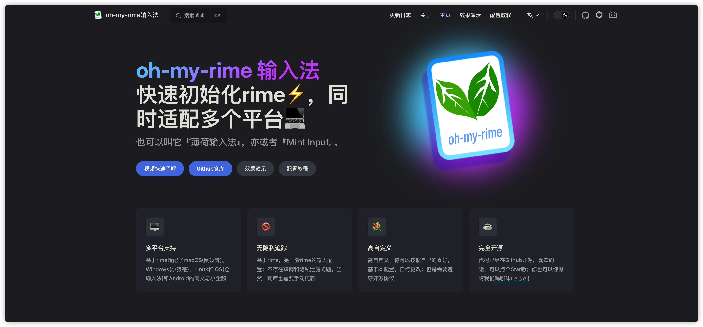

# 薄荷输入法文档 📝💨

[](https://www.mintimate.cc)

---

## 开发者指南

如果你想参与文档的编写，克隆本仓库，然后执行以下命令： 
```bash
# 安装依赖
yarn install
# 运行
yarn dev
# 打包(输出到 .vitepress/dist)
yarn build
```

如果你想参与薄荷配置的编写，可以前文：
- [oh-my-rime: https://github.com/Mintimate/oh-my-rime](https://github.com/Mintimate/oh-my-rime)

## Umami 访客统计

站点通过 `.vitepress/theme/plugins/umami/` 中的 Vue 插件展示 Umami v2 数据：文档顶部展示本页访客数与浏览量，底部展示全站统计，首页同时展示两者。中英文、暗色模式和 VitePress 页面切换均可使用。

配置集中维护在 [CNB 密钥仓库的 DocVitePressOMR.yaml](https://cnb.cool/Mintimate/secret/-/blob/main/DocVitePressOMR.yaml)，构建流水线通过 `imports` 注入环境变量：

| 变量 | 用途 |
| --- | --- |
| `UMAMI_BASE_URL` | Umami 服务地址，不含末尾 `/script.js` |
| `UMAMI_WEBSITE_ID` | 网站 ID |
| `UMAMI_SHARE_ID` | 已启用的共享链接 ID |
| `UMAMI_STATS_DAYS` | 统计天数，默认 30 |
| `UMAMI_CACHE_TTL_MS` | 浏览器缓存毫秒数，默认 300000 |
| `UMAMI_EXCLUDE_HASH` | 采集时忽略锚点，默认 `true` |

EdgeOne CLI 会拉取控制台配置到 `.env`，构建子进程也不会继承 CNB 的全部环境变量。因此流水线先运行 `.cnb/scripts/prepare-umami-env.mjs`，仅将以上六项公开配置写入被 Git 忽略的 `.env.production.local`，供 VitePress 构建读取。前三项缺失或配置无效时直接终止部署，避免发布没有统计栏的页面。无需在 EdgeOne 控制台重复配置这些变量。

`.vitepress/config/umami.mjs` 只负责校验和挑选上述字段，具体站点值不写入源码。VitePress 在构建时将这几个公开字段写入 `themeConfig.umami`，其他环境变量不会由这条配置通道传给浏览器。共享 ID 会被浏览器使用，放在密钥仓库中是为了集中管理，不改变其公开分享属性。

本地开发可参考 `.env.example` 创建被 Git 忽略的 `.env.local`。未配置站点时关闭采集和统计；仅缺少共享 ID 时保留采集、隐藏统计。修改环境变量后需要重启开发服务器或重新构建。

插件通过 `/api/share/:shareId` 获取该公开站点的只读分享 token，再读取 `/api/websites/:websiteId/stats`；不需要配置账号密码或登录 token。Umami 服务器必须允许站点跨域 GET 请求及 `x-umami-share-token` 请求头。重新生成共享链接后，需要同步修改 `UMAMI_SHARE_ID` 并重新构建。

插件在浏览器挂载后加载数据，不影响静态构建。同一浏览器内复用请求并缓存 5 分钟，切换页面或回到标签页时检查缓存；它不是实时在线人数。请求失败显示 `—` 并可重试，不会误显示为 0。访客数以 Umami 的区间去重口径为准，全站访客数不能由各页面访客数相加得到。

本页按实际 `pathname` 精确查询，保留 `.html` 和末尾 `/`，避免把子页面误计入当前页。默认通过 `UMAMI_EXCLUDE_HASH=true` 设置采集脚本的 `data-exclude-hash="true"`，新增访问不再按章节锚点拆分。历史带 `#锚点` 的记录仍单独存储，不包含在无锚点路径的本页统计中；全站统计包含它们。

需要在 Markdown 中手动插入时，可使用 `<UmamiStats />`，或使用 `scope="site"` / `scope="page"` 只展示一类统计。页面 frontmatter 设置 `umami: false` 可隐藏该页统计。

验证静态构建：`npm run build`。

## 特别感谢

感谢 [Vitepress](https://vitepress.dev/) 和 [Vite](https://github.com/vitejs/vite) 提供的强大支持。

## 许可证

[GPL-3.0](LICENSE)

Copyright (c) 2023-present, [Mintimate](https://www.mintimate.cn)
